# Doctor Tracker

Doctor Tracker is an admin portal for clinics that keeps every doctor, their patients and current clinical load in one place. Admins register doctors, assign and update patients, and see at a glance who is critical, which doctors carry the most load and how admissions are trending, all behind a secured sign-in.

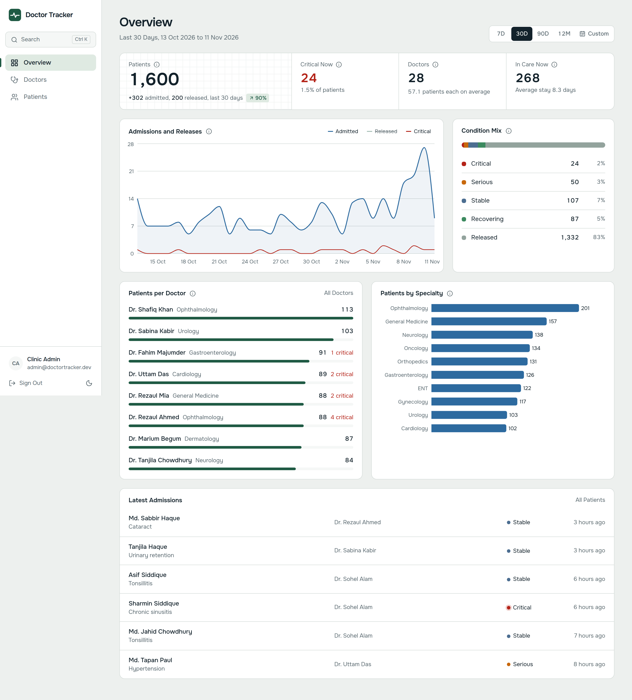

## Stack

| Layer | Choice |
| --- | --- |
| Client | Next.js 16 (App Router, React 19, React Compiler), TanStack Query, Tailwind CSS 4, Recharts, Radix primitives |
| API | Node.js 20, Express 5, Zod, JWT (httpOnly cookie), Helmet, express-rate-limit, Pino |
| Database | MongoDB 7 with Mongoose 9 |
| Quality | TypeScript strict, ESLint, Vitest + Supertest + mongodb-memory-server, GitHub Actions workflow |

## Setup

Full Windows and Linux steps are in **[SETUP.md](SETUP.md)**. Quick version, once MongoDB is running:

```bash
npm install
# copy server/.env.example to server/.env and client/.env.example to client/.env.local
# put the output of `npm run secret` into JWT_SECRET in both files
npm run seed
npm run dev          # API on :4000, client on http://localhost:3000
```

**Credentials:** see [credentials.md](credentials.md). Seed defaults: admin `admin@doctortracker.dev` / `ChangeMe!2026`, viewer `viewer@doctortracker.dev` / `ViewOnly!2026`.

### Docker (whole stack)

```bash
cp .env.example .env                        # set JWT_SECRET
docker compose up --build -d
docker compose run --rm api node server/dist/scripts/seed.js
```

### Scripts (run from the root)

| Command | Does |
| --- | --- |
| `npm run dev` | API and client in watch mode |
| `npm start` | Both apps from a production build (`npm run build` first) |
| `npm run secret` | Prints a random `JWT_SECRET` |
| `npm run seed` | Admin and viewer users plus demo data |
| `npm run create-user -- <email> <password> <admin\|viewer> [name]` | Create a user or reset one |
| `npm run explain` | Print the MongoDB query plan for every list and dashboard query |
| `npm test` | API integration tests and client unit tests |
| `npm run ci` | Lint, typecheck, test, build: the same steps as CI |

### Environment

| Variable | App | Purpose |
| --- | --- | --- |
| `MONGODB_URI` | server | Connection string |
| `JWT_SECRET` | server, client | Signs sessions (server); lets `proxy.ts` reject forged or expired cookies early (client) |
| `JWT_TTL_HOURS` | server | Session length, default 8 |
| `CLIENT_ORIGIN` | server | Allowed origin(s) for state-changing requests |
| `TRUST_PROXY` | server | Proxy hops in front of the API, for correct client IPs |
| `ADMIN_EMAIL`, `ADMIN_PASSWORD` | server | First admin, used by the seed |
| `VIEWER_EMAIL`, `VIEWER_PASSWORD` | server | Optional read-only user, used by the seed |
| `API_URL` | client | Where `/api/*` is forwarded. Read at build time |
| `NEXT_PUBLIC_DEMO_LOGIN` | client | Optional `email:password` to show a "Use demo account" button |

## System architecture

```
 Browser
   │  same origin only: pages + /api/*  (httpOnly session cookie, SameSite=Lax)
   ▼
 Next.js client  :3000
   ├─ proxy.ts        verifies session JWT, redirects signed-out users to /login
   ├─ App Router      Overview, Doctors, Doctor detail, Patients, Login
   ├─ TanStack Query  server cache, URL-driven filters, optimistic deletes
   └─ rewrite         /api/:path*  ──►  API_URL/api/v1/:path*
                                           │
                                           ▼
 Express API  :4000  (separate service)
   ├─ helmet, JSON limit 20kb, pino logging
   ├─ csrfGuard       Origin allow-list + X-Requested-With on writes
   ├─ /auth           login (rate limited), logout (revokes), me
   ├─ requireAuth     every role reads; writes need admin
   ├─ /doctors        CRUD, search, filters, /:id/patients
   ├─ /patients       CRUD, search, filters
   └─ /stats          dashboard aggregations
                                           │
                                           ▼
 MongoDB
   users, doctors, patients (doctor ref, indexed)
```

**Request flow:** a page reads its filters from the URL, TanStack Query calls `/api/...` on the same origin, Next forwards it to Express, Express validates the input with Zod, runs an index-backed query and returns `{ items, page, limit, total, pages }`. Writes invalidate the related list and stats caches.

### Folder layout

```
doctor-tracker/
├─ server/src
│  ├─ config/env.ts          validated environment
│  ├─ models/                user, doctor, patient (+ indexes)
│  ├─ modules/<feature>/     routes, schemas, service per feature
│  ├─ middleware/            auth, csrf, validation, errors
│  ├─ lib/                   search, pagination, validators
│  └─ scripts/              seed, create-user, explain
├─ server/test/              integration tests against in-memory MongoDB
├─ client/src
│  ├─ app/                   routes: (app)/, (app)/doctors/[id], login
│  ├─ components/            ui/, layout/, dashboard/, doctors/, patients/
│  ├─ hooks/                 queries.ts, use-url-state.ts, use-can.ts
│  ├─ lib/                   api client, schemas, types, format
│  └─ proxy.ts
└─ docker-compose.yml
```

### API

All routes are under `/api/v1` and need a session. `GET` works for every role, and anything else needs `admin` (otherwise 403). Errors come back as `{ error: { code, message, details? } }`.

| Method | Path | |
| --- | --- | --- |
| POST | `/auth/login`, `/auth/logout` | GET `/auth/me` |
| GET, POST | `/doctors` | list with `q, specialization, hospital, from, to, sort, page, limit` |
| GET, PATCH, DELETE | `/doctors/:id` | includes a 12-month admissions trend; delete returns 409 while patients are assigned |
| GET, POST | `/doctors/:id/patients` | a doctor's list, add under that doctor |
| DELETE | `/doctors/:id/patients/:patientId` | scoped remove |
| GET | `/doctors/lookup`, `/doctors/facets` | picker search, hospital list |
| GET, POST | `/patients` | list with `q, condition, specialization, gender, doctor, ageMin, ageMax, from, to, sort, page, limit` |
| GET, PATCH, DELETE | `/patients/:id` | |
| GET | `/stats/overview?range=7d\|30d\|90d\|12m` or `?from=&to=` | all dashboard figures in one call; custom ranges up to 731 days, bucketed by day, week or month by length |

## Technical decisions

### 1. One origin for the browser, two services behind it

The brief requires the client and the API to be separate apps. Calling the API directly from the browser would make the session cookie cross-site, which means `SameSite=None`, credentialed CORS, and weaker CSRF protection.

Instead, Next.js forwards `/api/*` to Express. The browser only ever talks to one origin, so the JWT sits in an **httpOnly, SameSite=Lax** cookie that scripts cannot read and other sites cannot send. Express stays a standalone service, can be scaled or deployed on its own, and still checks the `Origin` header plus a custom request header on every write. Sessions carry a `tokenVersion`, so signing out revokes the token on the server too, not just in the browser.

*Trade-off:* one extra hop through Next. It is a plain stream on the same network and far cheaper than handling cross-site cookies.

### 2. Index-friendly search, with the URL as the state store

**Search.** A `$regex` with `i` or an unanchored pattern scans the whole collection, and `$text` cannot match partial words. On save, each doctor and patient stores a lowercased `keywords` array (name, hospital, specialty, diagnosis, phone digits) with a multikey index. A query like `far kab` becomes `{ keywords: { $all: [/^far/, /^kab/] } }`. Anchored, case-sensitive prefixes become index range scans, so "Farhana Kabir" is found as you type. Input is tokenised and escaped, so typed text never runs as a regex.

**Indexes match the access paths:** `{doctor, admittedAt, _id}` for a doctor's page and per-doctor counts, `{condition, admittedAt, _id}` for condition filters, `{admittedAt, _id}` for the default sort, and a unique `email` index. Every sort adds `_id` as a tiebreaker so pages never repeat or skip rows, and the indexes end in `_id` to match. Running `npm run explain` showed why that matters: without the trailing `_id`, a condition filter read 92 documents to return 10. List data and `countDocuments` run in parallel. The dashboard is a single endpoint running nine index-backed aggregations in parallel.

**State.** Redux was not needed: nearly all state is server data. TanStack Query owns caching, deduplication, `keepPreviousData` paging without flicker, and optimistic deletes with rollback. Filters, search, sort and page live in the URL, so every view can be bookmarked and the back button works. The React Compiler removes most of the need for manual memoisation.

## Features beyond the brief

- **Ctrl+K search:** jump to any doctor, patient or page from anywhere. Selecting a patient opens their record.
- **Custom date range:** besides 7D, 30D, 90D and 12M, the Overview takes any range up to two years, with This Month, Last Month, This Year and Last Year presets. Every figure follows it, and the range is kept in the URL.
- **Chart toggles:** the admissions legend shows or hides each line. Released starts hidden.
- **Clickable charts:** select a day on the admissions chart, or a specialty bar, to open the matching patient list.
- **Doctor trend:** each doctor page shows 12 months of admissions next to their condition mix.
- **Release and readmit:** record when a patient leaves care. Patient lists filter by In care or Released and show each patient's length of stay. The dashboard tracks releases against admissions.
- **Read-only role:** viewers see everything, and patient records open read-only.
- **Shareable state:** filters, sort, page and the open patient all live in the URL.

## Query plans

Every list query reads exactly the documents it returns. The `0` docs-examined rows are covered queries, answered from the index alone. Deep `skip` paging is the one known cost; keyset paging is the next step if lists grow large.

Plans on 28 doctors and 1600 patients (`npm run explain`).

| Query | Index used | Keys examined | Docs examined | Returned | ms |
| --- | --- | ---: | ---: | ---: | ---: |
| Doctors: default page (newest first) | `createdAt_-1__id_-1` | 10 | 10 | 10 | 0 |
| Doctors: search "yas" | `keywords_1` | 1 | 1 | 1 | 0 |
| Doctors: filter by specialty | `specialization_1_createdAt_-1__id_-1` | 2 | 2 | 2 | 0 |
| Doctors: patient counts for one page | `doctor_1_admittedAt_-1__id_-1` | 594 | 0 | 588 | 1 |
| Patients: default page (latest admitted) | `admittedAt_-1__id_-1` | 10 | 10 | 10 | 0 |
| Patients: deep page 100 (skip 990) | `admittedAt_-1__id_-1` | 1000 | 10 | 10 | 1 |
| Patients: search "hyper" | `keywords_1` | 50 | 49 | 10 | 1 |
| Patients: condition = critical | `condition_1_admittedAt_-1__id_-1` | 10 | 10 | 10 | 0 |
| Patients: one doctor's list | `doctor_1_admittedAt_-1__id_-1` | 10 | 10 | 10 | 0 |
| Patients: admitted in last 30 days | `admittedAt_-1__id_-1` | 10 | 10 | 10 | 0 |
| Patients: critical + last 30 days | `condition_1_admittedAt_-1__id_-1` | 10 | 10 | 10 | 0 |
| Patients: in care only | `releasedAt_1_admittedAt_-1__id_-1` | 10 | 10 | 10 | 0 |
| Dashboard: releases per day, 30 days | `releasedAt_1_admittedAt_-1__id_-1` | 202 | 0 | 202 | 0 |
| Dashboard: admissions per day, 30 days | `admittedAt_-1__id_-1` | 305 | 0 | 305 | 1 |

## Quality audits

| Page | Lighthouse desktop (perf, a11y, best practices) | Lighthouse mobile | axe (WCAG 2.1 AA) |
| --- | --- | --- | --- |
| Login | 100, 100, 100 | 97, 100, 100 | 0 issues |
| Overview | 99, 100, 100 | 74, 100, 100 | 0 issues (light and dark) |
| Doctors | 99, 100, 100 | 80, 100, 100 | 0 issues |
| Patients | 100, 100, 100 | 77, 100, 100 | 0 issues |

Mobile performance uses Lighthouse's throttled CPU and slow 4G. The time goes to data that loads only after the JavaScript starts. Prefetching the first page of data on the server would remove that wait, and is the next performance step.

## Security

- bcrypt (cost 12) passwords, generic login errors, and a constant-time path for unknown emails
- Login rate limit of 10 failed attempts per 15 minutes
- Every input parsed by Zod (unknown keys dropped, nested query objects disabled), so Mongo operator injection is rejected
- Helmet headers on the API; `X-Frame-Options`, `nosniff`, `Referrer-Policy` and `Permissions-Policy` on the client
- `?next=` redirects limited to same-site paths
- Pino logs redact cookies and passwords, and 500 responses never leak stack traces

## Product decisions

The brief left these open, so they were decided here:

| Gap | Decision |
| --- | --- |
| Patient "condition" undefined | Severity scale: critical, serious, stable, recovering, plus released. A separate free-text `diagnosis` holds the medical condition |
| Leaving care | Not in the brief. **Release** records `releasedAt` and sets the condition to released, and **Readmit** reverses it. Released can only be set this way. The dashboard tracks releases alongside admissions, and shows patients in care and average stay |
| Date filters | Doctors filter by join date, patients by admission date (future dates rejected) |
| Other filters | Doctors: specialty, hospital. Patients: doctor, the doctor's specialty, gender, age band |
| Deleting a doctor with patients | Blocked with 409 and a clear message, so no patients are left orphaned |
| Edit and delete doctors | Added, though only create was required |
| Roles | `admin` can do everything. `viewer` can browse but not change anything: the API returns 403 and the UI hides the write controls |

## Testing

```bash
npm test
```

- **API (33 tests):** auth (cookie flags, revocation, tampered tokens, CSRF, operator injection), viewer role limits, release and readmit, custom stats ranges, doctor and patient CRUD, scoped deletes, search, filters, pagination, and stats aggregation, all against an in-memory MongoDB.
- **Client (21 tests):** redirect safety, form schemas, DD-MM-YYYY date parsing, formatting.

## Screenshots

| Desktop | Mobile |
| --- | --- |
|  | 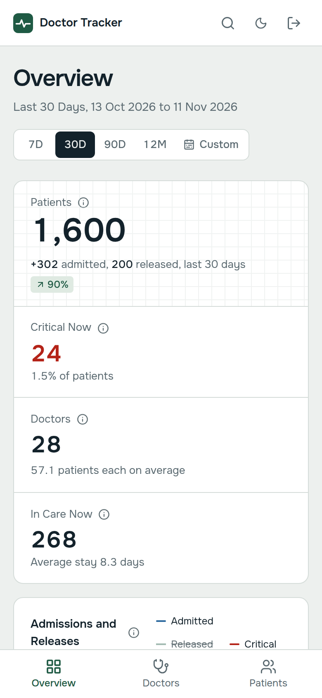 |
| 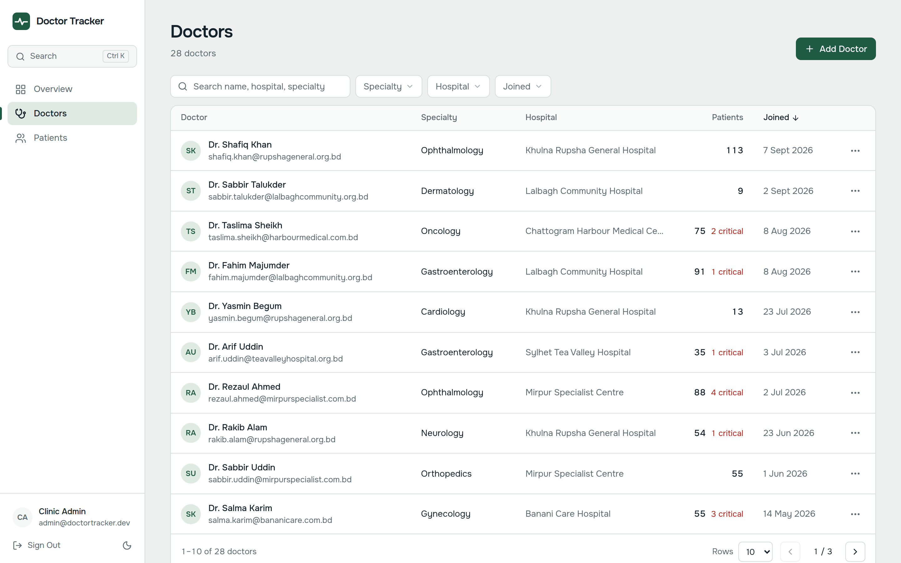 | 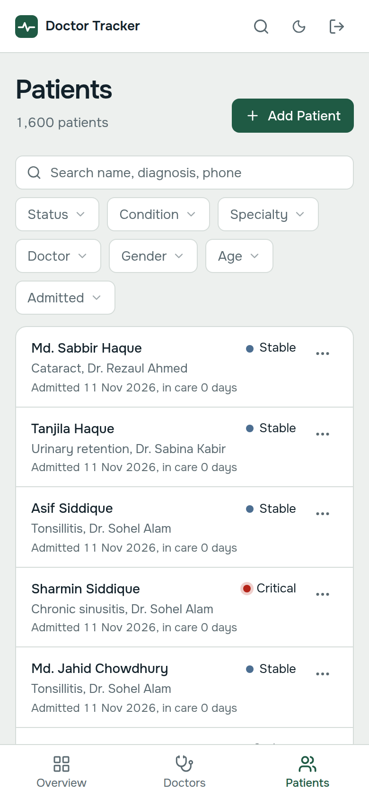 |
| 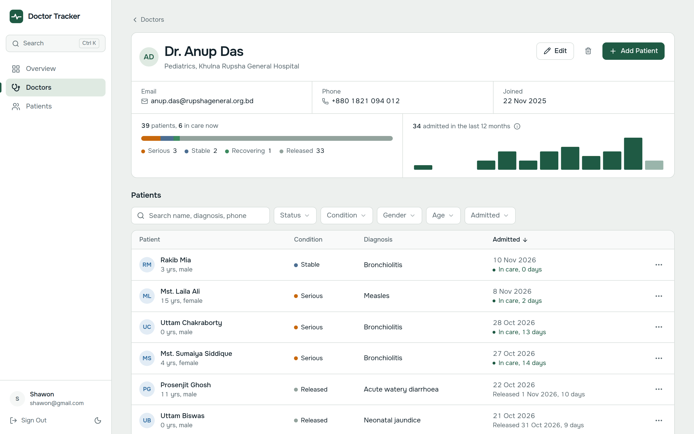 | 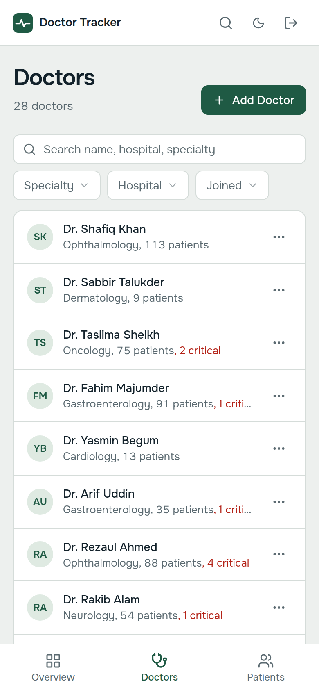 |
| 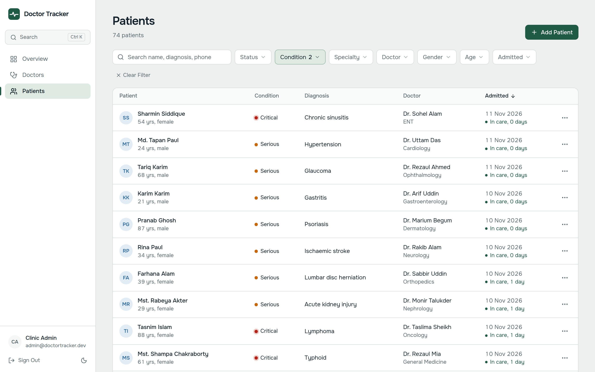 | 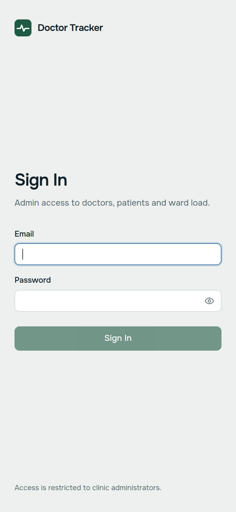 |
| 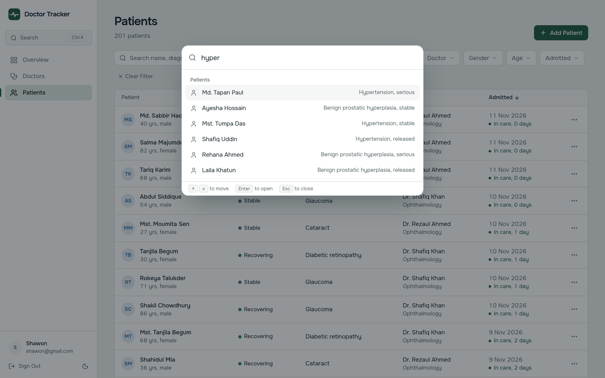 | |
| 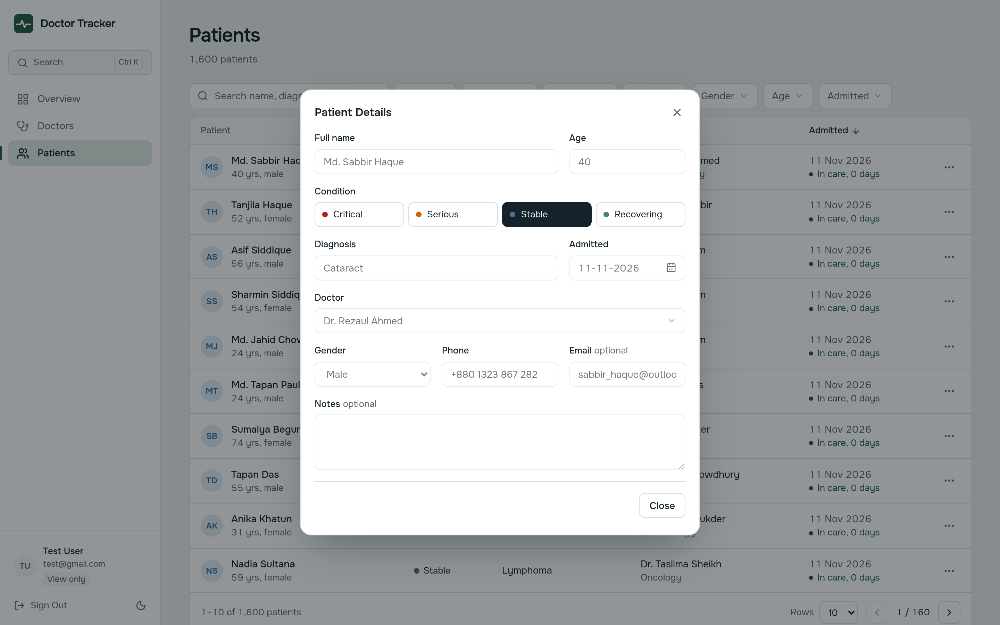 | |
| 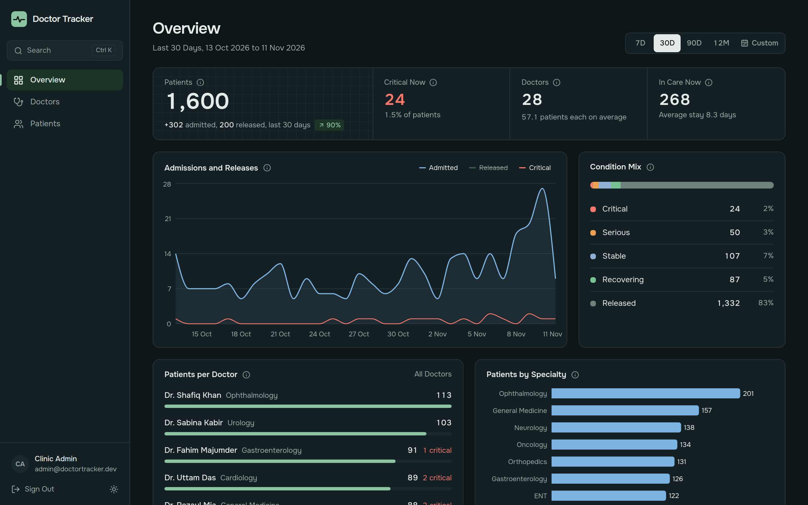 | |
