# Architecture

Technical reference for Doctor Tracker: system design, API, key decisions, security and quality results. For setup, see [SETUP.md](../SETUP.md). For index and query plans, see [query-plans.md](query-plans.md).

## System overview

```
 Browser
   │  same origin only: pages + /api/*  (httpOnly session cookie, SameSite=Lax)
   ▼
 Next.js client  :3000
   ├─ proxy.ts        verifies session JWT, redirects signed-out users to /login
   ├─ App Router      Overview, Doctors, Doctor detail, Patients, Login
   ├─ TanStack Query  server cache, URL-driven filters, optimistic deletes
   └─ rewrite         /api/:path*  ──►  API_URL/api/v1/:path*
                                           │
                                           ▼
 Express API  :4000  (separate service)
   ├─ helmet, JSON limit 20kb, pino logging
   ├─ csrfGuard       Origin allow-list + X-Requested-With on writes
   ├─ /auth           login (rate limited), logout (revokes), me
   ├─ requireAuth     every role reads; writes need admin
   ├─ /doctors        CRUD, search, filters, /:id/patients
   ├─ /patients       CRUD, search, filters
   └─ /stats          dashboard aggregations
                                           │
                                           ▼
 MongoDB
   users, doctors, patients (doctor ref, indexed)
```

**Request flow:** a page reads its filters from the URL, TanStack Query calls `/api/...` on the same origin, Next forwards it to Express, Express validates the input with Zod, runs an index-backed query and returns `{ items, page, limit, total, pages }`. Writes invalidate the related list and stats caches.

## Folder layout

```
doctor-tracker/
├─ server/src
│  ├─ config/env.ts          validated environment
│  ├─ models/                user, doctor, patient (+ indexes)
│  ├─ modules/<feature>/     routes, schemas, service per feature
│  ├─ middleware/            auth, csrf, validation, errors
│  ├─ lib/                   search, pagination, validators
│  └─ scripts/               seed, create-user, explain
├─ server/test/              integration tests against in-memory MongoDB
├─ client/src
│  ├─ app/                   routes: (app)/, (app)/doctors/[id], login
│  ├─ components/            ui/, layout/, dashboard/, doctors/, patients/
│  ├─ hooks/                 queries.ts, use-url-state.ts, use-can.ts
│  ├─ lib/                   api client, schemas, types, format
│  └─ proxy.ts
└─ docker-compose.yml
```

## API

All routes are under `/api/v1` and need a session. `GET` works for every role, and anything else needs `admin` (otherwise 403). Errors come back as `{ error: { code, message, details? } }`.

| Method | Path | Notes |
| --- | --- | --- |
| POST | `/auth/login`, `/auth/logout` | GET `/auth/me` |
| GET, POST | `/doctors` | list with `q, specialization, hospital, from, to, sort, page, limit` |
| GET, PATCH, DELETE | `/doctors/:id` | includes a 12-month admissions trend; delete returns 409 while patients are assigned |
| GET, POST | `/doctors/:id/patients` | a doctor's list, add under that doctor |
| DELETE | `/doctors/:id/patients/:patientId` | scoped remove |
| GET | `/doctors/lookup`, `/doctors/facets` | picker search, hospital list |
| GET, POST | `/patients` | list with `q, condition, specialization, gender, doctor, ageMin, ageMax, from, to, sort, page, limit` |
| GET, PATCH, DELETE | `/patients/:id` | |
| GET | `/stats/overview?range=7d\|30d\|90d\|12m` or `?from=&to=` | all dashboard figures in one call; custom ranges up to 731 days, bucketed by day, week or month by length |

## Technical decisions

### One origin for the browser, two services behind it

Calling the API directly from the browser would make the session cookie cross-site, which means `SameSite=None`, credentialed CORS, and weaker CSRF protection.

Instead, Next.js forwards `/api/*` to Express. The browser only ever talks to one origin, so the JWT sits in an **httpOnly, SameSite=Lax** cookie that scripts cannot read and other sites cannot send. Express stays a standalone service, can be scaled or deployed on its own, and still checks the `Origin` header plus a custom request header on every write. Sessions carry a `tokenVersion`, so signing out revokes the token on the server too, not just in the browser.

*Trade-off:* one extra hop through Next. It is a plain stream on the same network and far cheaper than handling cross-site cookies.

### Index-friendly search, with the URL as the state store

**Search.** A `$regex` with `i` or an unanchored pattern scans the whole collection, and `$text` cannot match partial words. On save, each doctor and patient stores a lowercased `keywords` array (name, hospital, specialty, diagnosis, phone digits) with a multikey index. A query like `far kab` becomes `{ keywords: { $all: [/^far/, /^kab/] } }`. Anchored, case-sensitive prefixes become index range scans, so "Farhana Kabir" is found as you type. Input is tokenised and escaped, so typed text never runs as a regex.

**Indexes match the access paths:** `{doctor, admittedAt, _id}` for a doctor's page and per-doctor counts, `{condition, admittedAt, _id}` for condition filters, `{admittedAt, _id}` for the default sort, and a unique `email` index. Every sort adds `_id` as a tiebreaker so pages never repeat or skip rows. List data and `countDocuments` run in parallel. The dashboard is a single endpoint running nine index-backed aggregations in parallel.

**State.** Nearly all state is server data, so TanStack Query owns caching, deduplication, `keepPreviousData` paging and optimistic deletes with rollback. Filters, search, sort and page live in the URL, so every view can be bookmarked and the back button works.

## Product decisions

| Topic | Decision |
| --- | --- |
| Patient "condition" | Severity scale: critical, serious, stable, recovering, plus released. A separate free-text `diagnosis` holds the medical condition |
| Leaving care | **Release** records `releasedAt` and sets the condition to released. **Readmit** reverses it. The dashboard tracks releases alongside admissions, patients in care and average stay |
| Date filters | Doctors filter by join date, patients by admission date (future dates rejected) |
| Other filters | Doctors: specialty, hospital. Patients: doctor, the doctor's specialty, gender, age band |
| Deleting a doctor with patients | Blocked with 409, so no patients are left orphaned |
| Roles | `admin` can do everything. `viewer` can browse but not change anything: the API returns 403 and the UI hides write controls |

## Security

- bcrypt (cost 12) passwords, generic login errors, and a constant-time path for unknown emails
- Login rate limit of 10 failed attempts per 15 minutes
- Every input parsed by Zod (unknown keys dropped, nested query objects disabled), so Mongo operator injection is rejected
- Helmet headers on the API; `X-Frame-Options`, `nosniff`, `Referrer-Policy` and `Permissions-Policy` on the client
- `?next=` redirects limited to same-site paths
- Pino logs redact cookies and passwords, and 500 responses never leak stack traces

## Testing

```bash
npm test
```

- **API (33 tests):** auth (cookie flags, revocation, tampered tokens, CSRF, operator injection), viewer role limits, release and readmit, custom stats ranges, doctor and patient CRUD, scoped deletes, search, filters, pagination, and stats aggregation, all against an in-memory MongoDB.
- **Client (21 tests):** redirect safety, form schemas, DD-MM-YYYY date parsing, formatting.

## Quality audits

| Page | Lighthouse desktop (perf, a11y, best practices) | Lighthouse mobile | axe (WCAG 2.1 AA) |
| --- | --- | --- | --- |
| Login | 100, 100, 100 | 97, 100, 100 | 0 issues |
| Overview | 99, 100, 100 | 74, 100, 100 | 0 issues (light and dark) |
| Doctors | 99, 100, 100 | 80, 100, 100 | 0 issues |
| Patients | 100, 100, 100 | 77, 100, 100 | 0 issues |

Mobile performance uses Lighthouse's throttled CPU and slow 4G. Prefetching the first page of data on the server is the next performance step.

## Screenshots

| Desktop | Mobile |
| --- | --- |
| 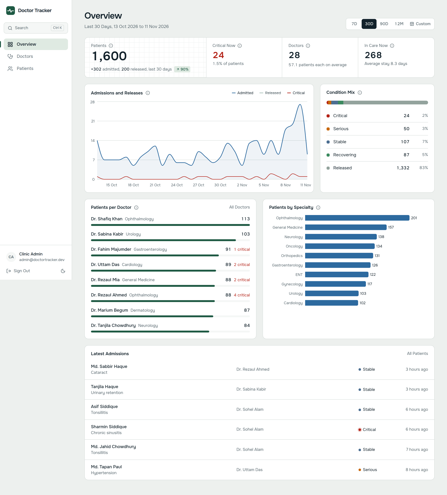 | 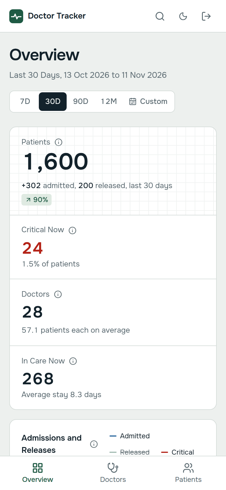 |
| 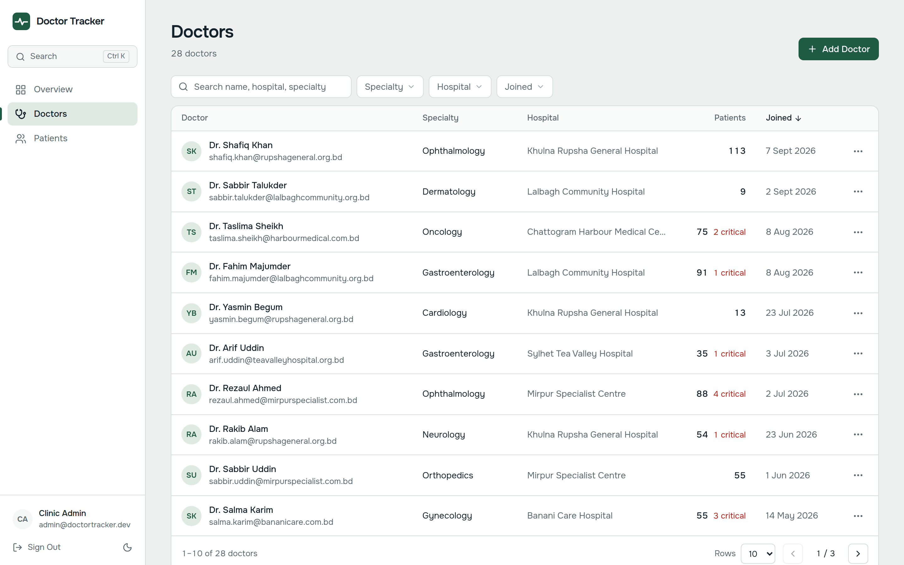 | 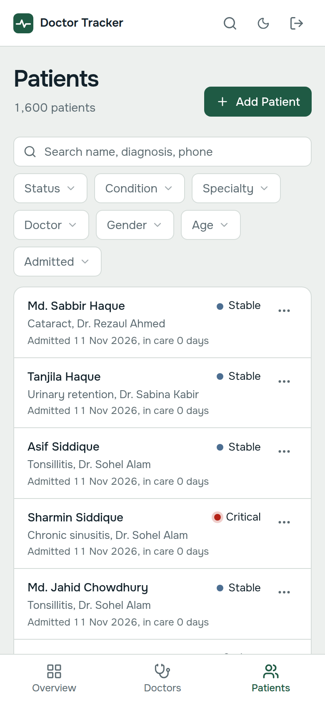 |
| 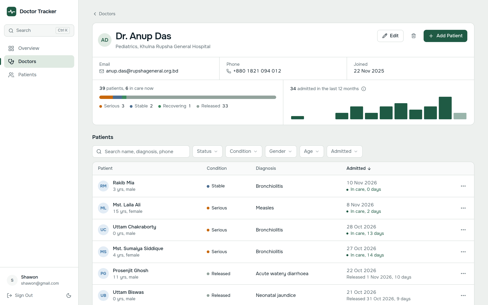 | 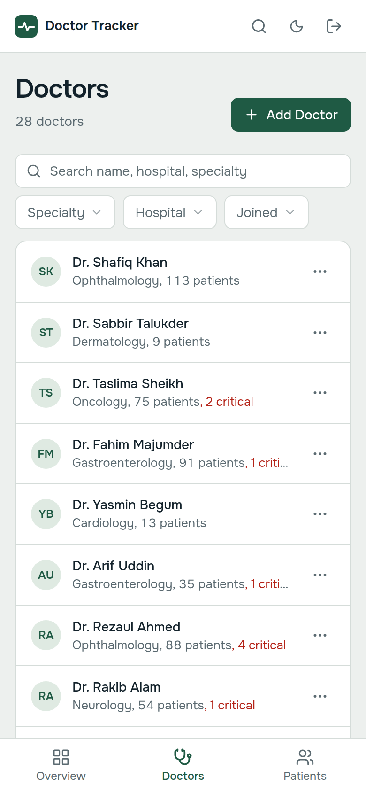 |
| 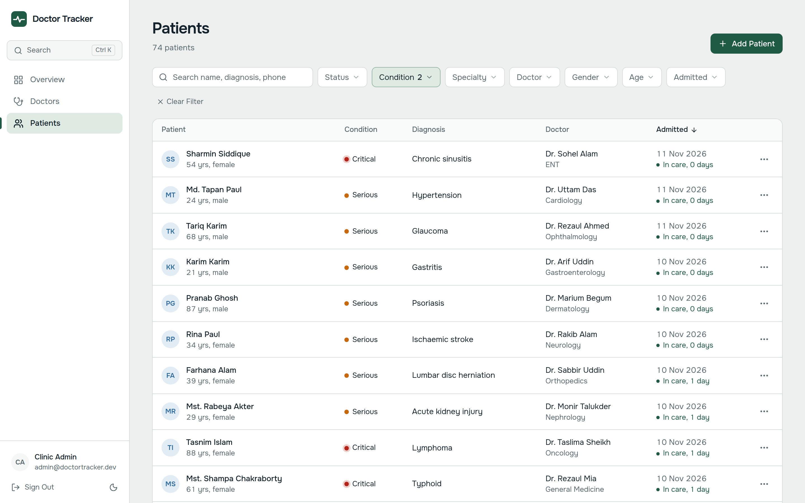 | 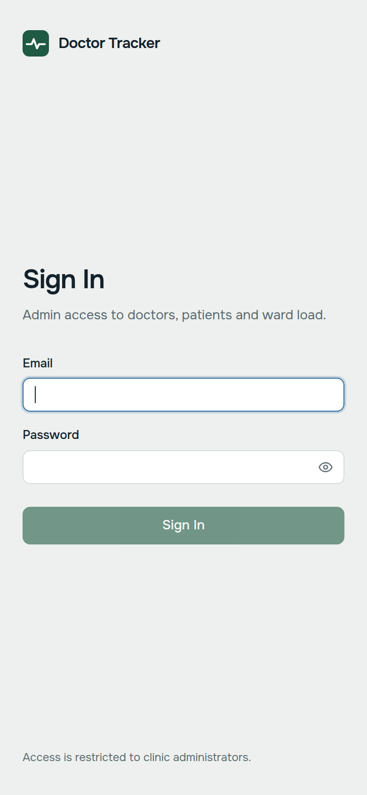 |
| 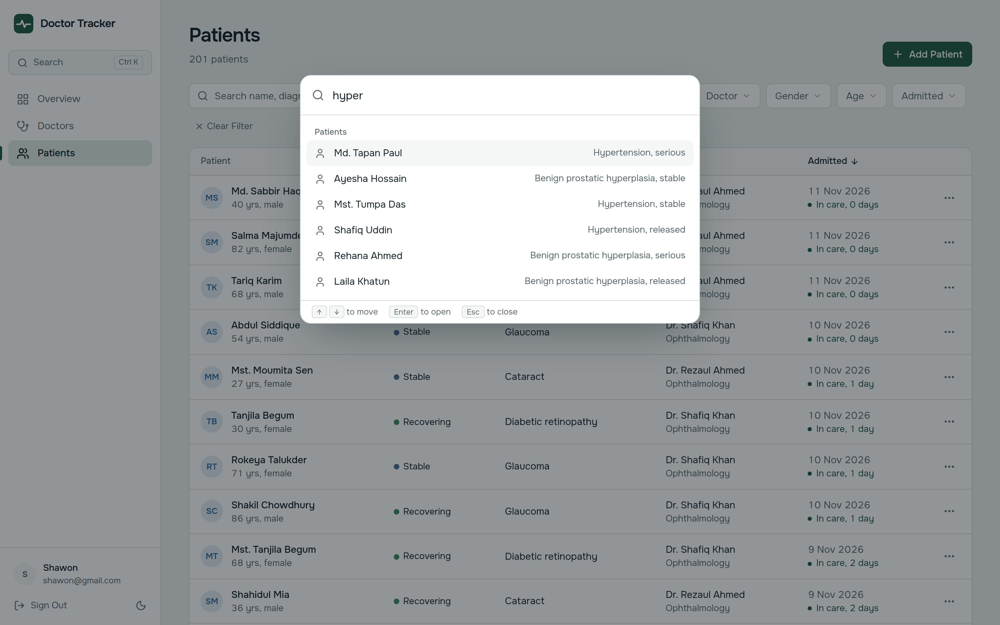 | |
| 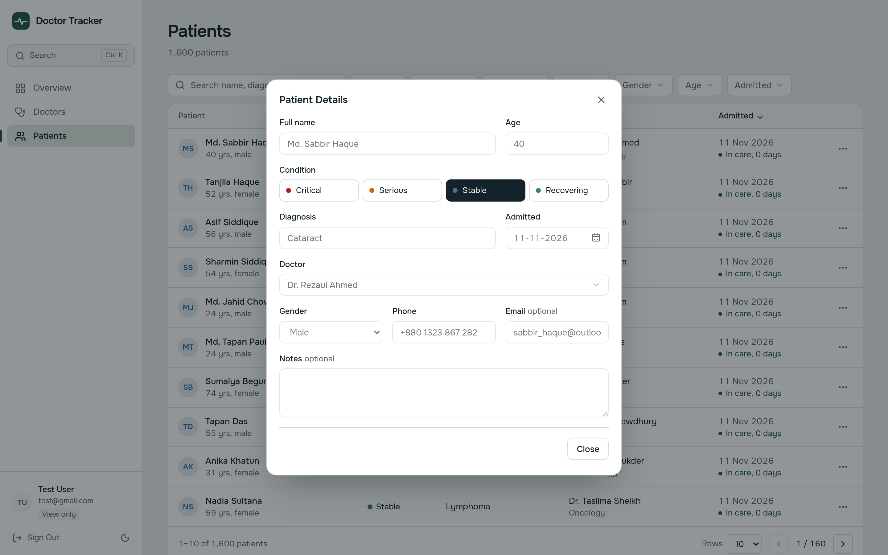 | |
| 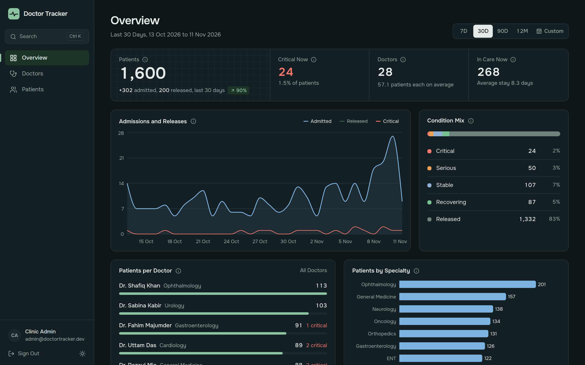 | |
